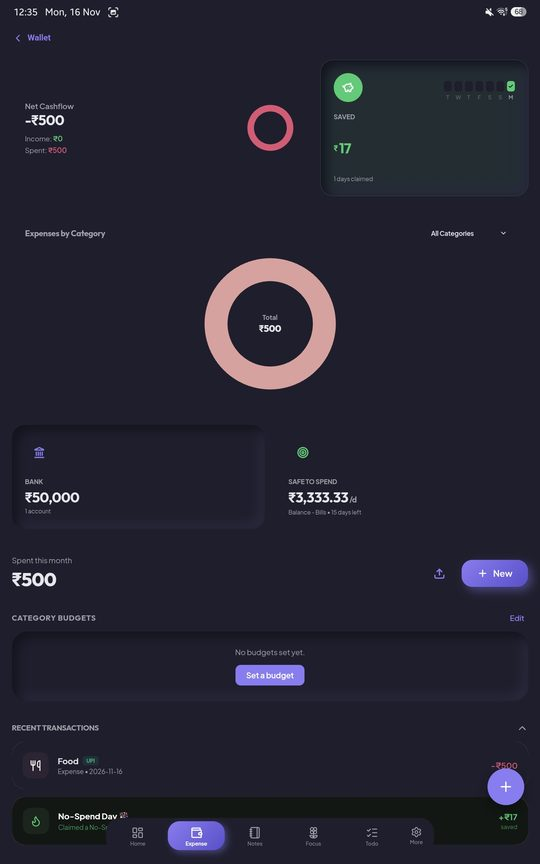
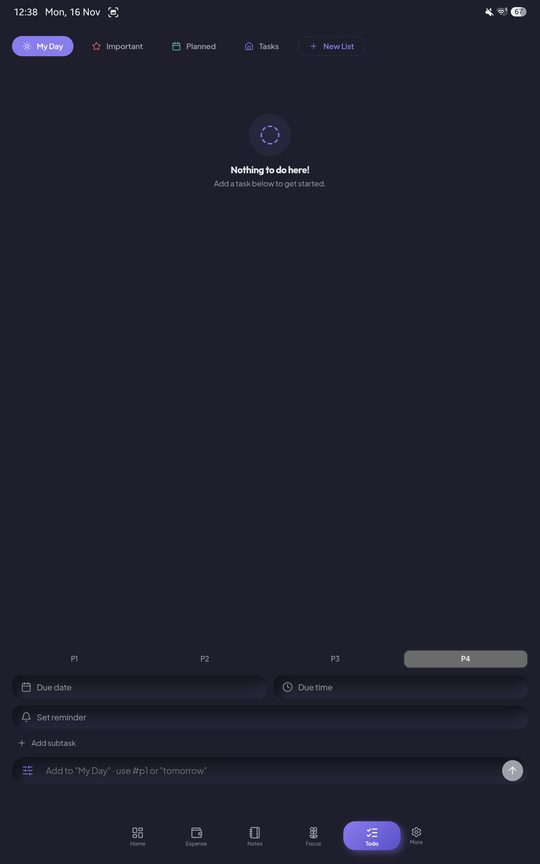
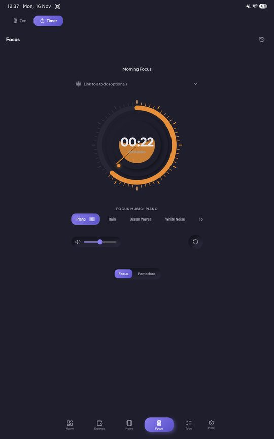
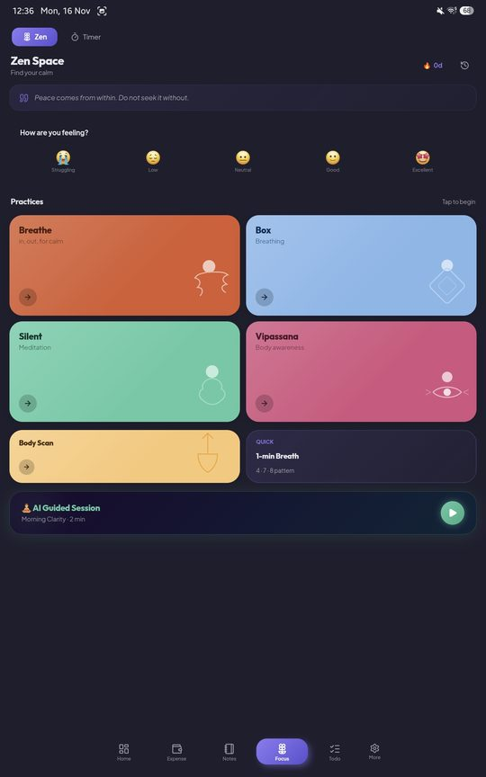

# Konto

A personal all-in-one app for Android and iOS: todos, expenses, notes, focus timers, and guided calm, in one dark, clay-soft UI.

Built for fun, mostly to see how far a single React codebase can go as a real mobile app.

<p align="center">
  
  
  
  
  
</p>

<details>
<summary>More screenshots</summary>
<br />
<p align="center">
  
  
  
  
  
</p>
</details>

## Why I built this

I wanted one app for the small daily things instead of juggling five. It also became a playground: native packaging with Capacitor, smooth animations, WebGL visuals, and Gemini for a bit of AI. A side project with no deadlines, so it's a good place to try things.

> Hobby project. Things may be rough, and features change whenever I feel like tinkering.

## What's inside

**Home**
- Daily dashboard: tasks, streak, focus minutes, spend
- Mood check-in, quick actions, mini timer, "My Day" list

**Expenses**
- Wallet view with net cashflow, category donut chart, balance, and safe-to-spend per day
- Category budgets, upcoming bills, burn rate
- No-spend day streaks
- Import from YNAB / Mint, with custom category rules for CSV imports

**Todo**
- My Day, Important, Planned, and custom lists
- P1–P4 priorities, due date and time, reminders, subtasks
- Quick add with shortcuts like `#p1` and `tomorrow`

**Focus**
- Focus timer and Pomodoro (breaks, cycles, streak)
- Ambient sounds: piano, rain, ocean waves, white noise
- Link a session to a todo

**Zen**
- Guided practices: breathing, box breathing, silent meditation, vipassana, body scan, 1-minute 4-7-8
- Mood check-in and AI-guided sessions

**Notes**
- Mood-tagged notes with tags and a block-style editor

**AI Insights**
- Gemini-powered insights and statement import

**Other**
- Offline-first, data stays on the device
- Base currency setting (INR by default), light/dark toggle
- Haptics, native share sheet, Excel export

## Built with

React 19 · Vite · TypeScript · Capacitor · Framer Motion · GSAP · Three.js / React Three Fiber · Recharts · Google Gemini · SheetJS

## Things I enjoyed figuring out

<!-- Edit with your real learnings -->
- Shipping a web app to Android and iOS with Capacitor
- Keeping animations smooth on mobile with WebGL in the mix
- Storing everything locally without a backend

## Run it

```bash
git clone https://github.com/Abhijit-Birle/universal-mobile-utility-app.git
cd universal-mobile-utility-app
npm install
npm run dev
```

AI features: open **More → Gemini API Key**, paste your key, and save. It is stored locally on your device.

On a device:

```bash
npm run build
npx cap sync
npx cap open android   # or: npx cap open ios
```

## What's next (maybe)

Cloud backup, widgets. No promises.

## Author

**Abhijit Birle** · [GitHub](https://github.com/Abhijit-Birle)
