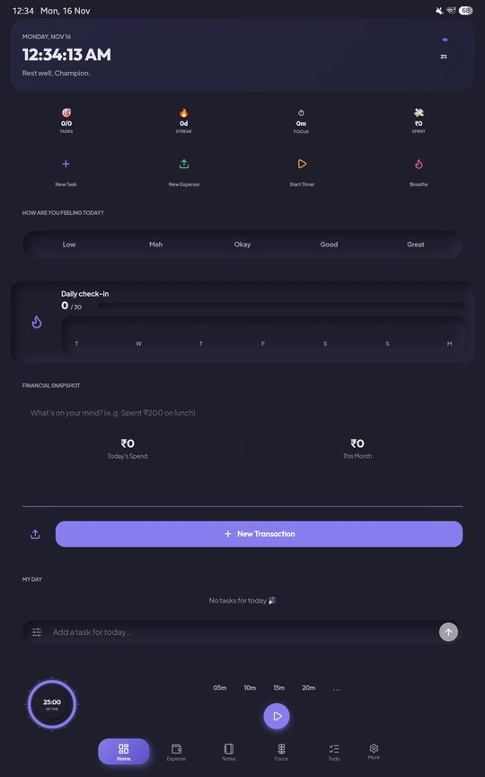
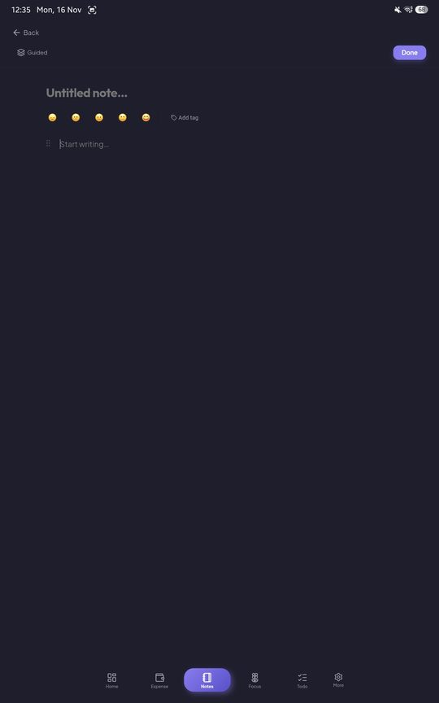
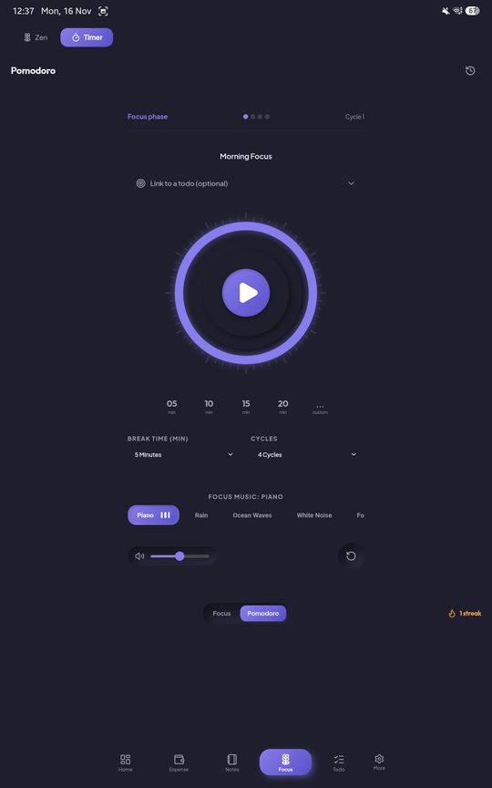
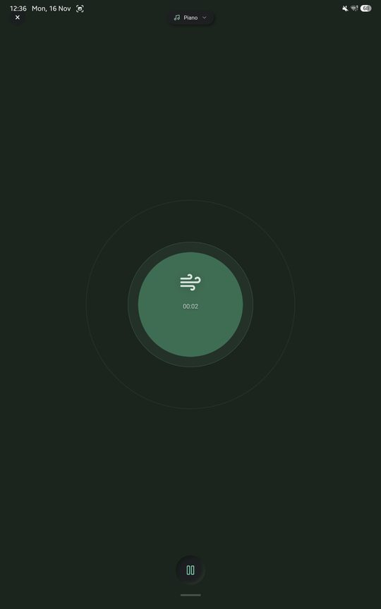
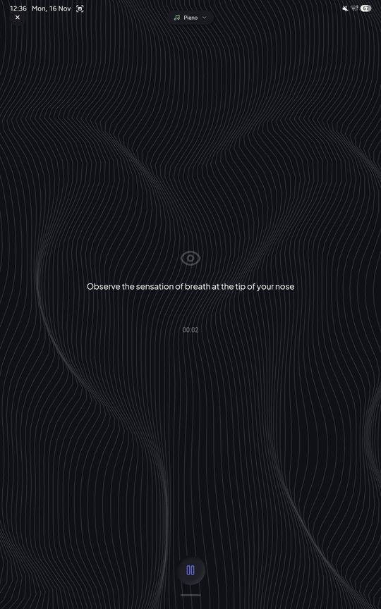
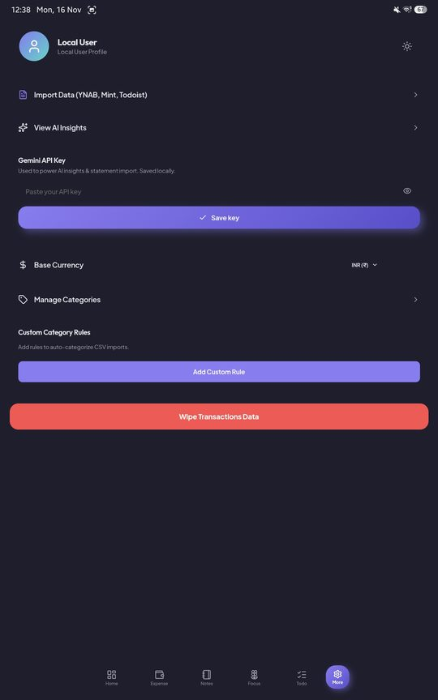

<div align="center">

# 💜 Konto

**One calm app for your tasks, money, notes, focus, and mind**

<a href="https://github.com/Abhijit-Birle/universal-mobile-utility-app">
  
</a>

<br />


<p>
  <a href="#-highlights">Highlights</a> ·
  <a href="#-screenshots">Screenshots</a> ·
  <a href="#-everything-inside">Everything inside</a> ·
  <a href="#-run-it">Run it</a>
</p>

</div>

---

## 👋 Why I built this

I wanted one app for the small daily things instead of juggling five. It also became a playground for native packaging with Capacitor, smooth animations, WebGL visuals, and a bit of AI.

> 🛠️ Hobby project. Rough edges included, and it changes whenever I feel like tinkering.

## ✨ Highlights

<table>
  <tr>
    <td width="50%" valign="top">
      <h3>💸 Expenses that guide you</h3>
      Net cashflow, category chart, <b>safe-to-spend per day</b>, budgets, upcoming bills, and no-spend day streaks. Import from YNAB or Mint.
    </td>
    <td width="50%" valign="top">
      <h3>✅ Fast todos</h3>
      My Day, Important, Planned, and custom lists. Priorities P1 to P4, reminders, subtasks, and quick add with <code>#p1</code> or <code>tomorrow</code>.
    </td>
  </tr>
  <tr>
    <td width="50%" valign="top">
      <h3>🎧 Focus mode</h3>
      Focus timer and Pomodoro with piano, rain, ocean, and white-noise backgrounds. Link a session to a todo.
    </td>
    <td width="50%" valign="top">
      <h3>🧘 Zen space</h3>
      Breathing, box breathing, silent meditation, vipassana, and body scan, plus AI-guided sessions.
    </td>
  </tr>
</table>

## 📸 Screenshots

<table align="center">
  <tr>
    <td align="center"><br /><sub><b>Home</b></sub></td>
    <td align="center"><br /><sub><b>Expenses</b></sub></td>
    <td align="center"><br /><sub><b>Todo</b></sub></td>
    <td align="center"><br /><sub><b>Focus</b></sub></td>
    <td align="center"><br /><sub><b>Zen</b></sub></td>
  </tr>
</table>

<details>
<summary><b>More screens</b></summary>
<br />

<table align="center">
  <tr>
    <td align="center"><br /><sub><b>Notes</b></sub></td>
    <td align="center"><br /><sub><b>Pomodoro</b></sub></td>
    <td align="center"><br /><sub><b>Breathe</b></sub></td>
    <td align="center"><br /><sub><b>Vipassana</b></sub></td>
    <td align="center"><br /><sub><b>Settings</b></sub></td>
  </tr>
</table>

</details>

## 📦 Everything inside

<details>
<summary><b>Home</b></summary>

- Daily dashboard: tasks, streak, focus minutes, spend
- Mood check-in, quick actions, mini timer, My Day list
</details>

<details>
<summary><b>Expenses and notes</b></summary>

- Wallet view, category budgets, bills, burn rate
- Import with custom category rules for CSV
- Mood-tagged notes with tags and a block-style editor
</details>

<details>
<summary><b>AI and settings</b></summary>

- Gemini-powered insights and statement import (add your key in More, saved locally)
- Base currency (INR by default), light/dark toggle
- Haptics, native share sheet, Excel export
- Offline-first: data stays on the device
</details>

## 🧰 Built with


Also: Recharts, SheetJS, Lucide.

## 🚀 Run it

```bash
git clone https://github.com/Abhijit-Birle/universal-mobile-utility-app.git
cd universal-mobile-utility-app
npm install
npm run dev
```

On a device:

```bash
npm run build
npx cap sync
npx cap open android   # or: npx cap open ios
```

For AI features, open **More → Gemini API Key** in the app and paste your key.

## 🗓️ What's next (maybe)

- [ ] Cloud backup
- [ ] Widgets

## 🙋 Author

**Abhijit Birle** · [GitHub](https://github.com/Abhijit-Birle)

<div align="center">
  <sub>Made for fun. ⭐ a star is always welcome.</sub>
</div>
